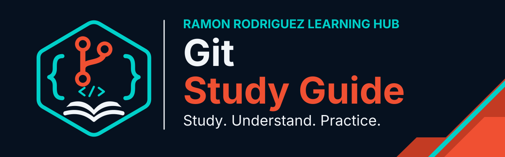

# Git Study Guide

### Study. Understand. Practice.

<strong>Choose your language</strong> Available in 3 languages

  
  
  

<!-- learning-hub:start -->

<strong>Ramon Rodriguez Learning Hub</strong> Explore. Learn. Build.

  
  
   Current guide: Git

<!-- learning-hub:end -->

Created and maintained by Ramon Rodriguez

  
  
  
  

<!-- technical-badges:start -->

<strong>Technology &amp; Continuous Integration</strong>

  
  
  
  
  

<strong>Tools &amp; Dependencies</strong>

  
  
  
  

<strong>Testing &amp; Execution</strong>

  
  
  

<strong>Documentation &amp; Repository Integrity</strong>

  
  
  
  
  
  
  
  
  
  

<strong>Engineering &amp; Development</strong>

  
  
  

Verified quality snapshot: <a href="https://github.com/RamonRDR/git-study-guide/actions/runs/46061260750">GitHub Actions run 46061260750</a>. Post-merge main 03c3043, 2026-11-27 UTC. Counts are snapshots, not live metrics. Both OS jobs run the same 152-test suite; do not sum them. Examples checks policy, not execution of every learner lab; links checks internal Markdown links, not external URL availability; secrets checks are heuristic.
<!-- technical-badges:end -->

A free, independent, multilingual guide to Git, GitHub, GitLab, version control and collaborative software engineering, from first commits to advanced workflows. No prior programming experience, paid service or AI assistant is required.

## How to study

Start with [Getting Started](getting-started/README.md), then follow the roadmap in order or use the command reference for targeted review. Read objectives, prerequisites, effects, risks and expected states before running commands. Use disposable repositories for practice, not this guide or a production repository. Projects and challenges are local practice; hosted activities are optional.

## Prerequisites

A computer, Git and a terminal or editor. Follow the installation chapter for supported platforms; many advanced labs use Git 2.40+ and Bash/Git Bash. The maintainer's CI uses Python 3.12 and its standard library; Python is not a learner prerequisite.

## Learning roadmap

<table align="center">
  <thead><tr><th scope="col">Order</th><th scope="col">Module</th><th scope="col">Entries</th></tr></thead>
  <tbody>
    <tr><td>00</td><td><a href="getting-started/README.md">Getting Started</a></td><td align="right">5</td></tr>
    <tr><td>01</td><td><a href="fundamentals/README.md">History &amp; Fundamentals</a></td><td align="right">3</td></tr>
    <tr><td>02</td><td><a href="git-architecture/README.md">Git Architecture</a></td><td align="right">3</td></tr>
    <tr><td>03</td><td><a href="basic-commands/README.md">Basic Git Commands</a></td><td align="right">5</td></tr>
    <tr><td>04</td><td><a href="branches/README.md">Branch Management</a></td><td align="right">5</td></tr>
    <tr><td>05</td><td><a href="merge-and-conflicts/README.md">Merge &amp; Conflicts</a></td><td align="right">7</td></tr>
    <tr><td>06</td><td><a href="remote-repositories/README.md">Remote Repositories</a></td><td align="right">5</td></tr>
    <tr><td>07</td><td><a href="history-and-recovery/README.md">History &amp; Recovery</a></td><td align="right">8</td></tr>
    <tr><td>08</td><td><a href="github/README.md">GitHub</a></td><td align="right">8</td></tr>
    <tr><td>09</td><td><a href="gitlab/README.md">GitLab</a></td><td align="right">8</td></tr>
    <tr><td>10</td><td><a href="ci-cd/README.md">CI/CD &amp; Automation</a></td><td align="right">10</td></tr>
    <tr><td>11</td><td><a href="professional-workflows/README.md">Professional Workflows</a></td><td align="right">13</td></tr>
    <tr><td>12</td><td><a href="security/README.md">Security &amp; Governance</a></td><td align="right">13</td></tr>
    <tr><td>13</td><td><a href="advanced-git/README.md">Advanced Git</a></td><td align="right">11</td></tr>
    <tr><td>14</td><td><a href="git-internals/README.md">Git Internals</a></td><td align="right">11</td></tr>
    <tr><td>15</td><td><a href="command-reference/README.md">Command Reference</a></td><td align="right">14</td></tr>
    <tr><td>16</td><td><a href="practical-projects/README.md">Practical Projects</a></td><td align="right">8</td></tr>
    <tr><td>17</td><td><a href="exercises/README.md">Challenges &amp; Interviews</a></td><td align="right">4</td></tr>
  </tbody>
</table>

## Current status

**Git Study Guide 1.0.** Curriculum modules 00–17 are implemented: 141 entries (115 lessons, 14 reference categories, eight project chapters and four assessment-bank chapters), 120 cataloged operations and 75 assessment records (36 quizzes, 12 challenges, 24 interview questions, three mocks). Final QA and publication evidence is tracked in [PR #22](https://github.com/RamonRDR/git-study-guide/pull/22); official published versions are listed in [Releases](https://github.com/RamonRDR/git-study-guide/releases). The versioned Learning Hub contract is prepared; browser runtime and site integration remain separate work.

- [Learning Hub handoff](docs/specs/project-foundation/handoff.md)

## Visual identity

Original branch symbol, shared hexagon, braces and open book with Git-orange accent. [Visual identity guide](docs/assets/learning-hub/README.md).

## Resources, governance and contribution

- [Learning path](docs/learning-path.md)
- [Command reference](command-reference/README.md)
- [Practical projects](practical-projects/README.md)
- [Challenges and interviews](exercises/README.md)
- [Project structure](docs/project-structure.md)
- [Quality automation](docs/quality-automation.md)
- [Roadmap](docs/roadmap.md)
- [Specifications](docs/specs/README.md)
- [Architecture decisions](docs/adr/README.md)
- [Contribution guide](CONTRIBUTING.md)
- [Authorship](AUTHORS.md)
- [Code of conduct](CODE_OF_CONDUCT.md)
- [Security policy](SECURITY.md)
- [Support](SUPPORT.md)
- [AI-assisted development](docs/ai-assisted-development/README.en.md)
- [MIT License](LICENSE)

Created and maintained by [Ramon Estevez Rodriguez](https://github.com/RamonRDR) (Ramon Rodriguez). ChatGPT and Codex assist planning and review; the human maintainer owns decisions and approvals. Independent educational project, not affiliated with, sponsored by or endorsed by Git, GitHub, GitLab, OpenAI or other organizations.
