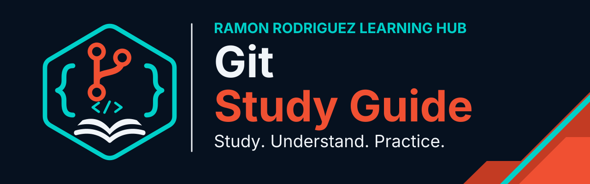

# Git Study Guide

### Estudia. Comprende. Practica.

<strong>Elige tu idioma</strong> Disponible en 3 idiomas

  
  
  

<!-- learning-hub:start -->

<strong>Ramon Rodriguez Learning Hub</strong> Explora. Aprende. Construye.

  
  
   Guía actual: Git

<a href="../specs/project-foundation/related-guides.es.md">Temas de estudio relacionados: Git y Python</a>

<!-- learning-hub:end -->

Creado y mantenido por Ramon Rodriguez

  
  
  
  

<!-- technical-badges:start -->

<strong>Tecnología e integración continua</strong>

  
  
  
  
  

<strong>Herramientas y dependencias</strong>

  
  
  
  

<strong>Pruebas y ejecución</strong>

  
  
  

<strong>Documentación e integridad del repositorio</strong>

  
  
  
  
  
  
  
  
  
  

<strong>Ingeniería y desarrollo</strong>

  
  
  

Snapshot de calidad verificado: <a href="https://github.com/RamonRDR/git-study-guide/actions/runs/46170050018">GitHub Actions run 46170050018</a>. Main post-merge c26c41f, 28/11/2026 UTC. Conteos son snapshots, no métricas en vivo. Ambos SO ejecutan la misma suite de 156 pruebas; no sumar. Examples comprueba política, no ejecución de todos los labs; links comprueba enlaces Markdown internos, no disponibilidad externa; secrets es heurístico.
<!-- technical-badges:end -->

Guía gratuita, independiente y multilingüe de Git, GitHub, GitLab, control de versiones e ingeniería de software colaborativa, desde el primer commit hasta flujos avanzados. No requiere experiencia en programación, servicio de pago ni IA.

## Cómo estudiar

Comienza con [Primeros pasos](../../getting-started/README.es.md), sigue el roadmap o usa la referencia de comandos para consultar. Lee objetivos, requisitos, efectos, riesgos y estados esperados antes de ejecutar comandos. Practica en repositorios desechables, nunca en esta guía ni en producción. Proyectos y desafíos son locales; actividades alojadas opcionales.

## Requisitos previos

Computadora, Git y terminal o editor. Sigue la lección de instalación; muchos laboratorios avanzados utilizan Git 2.40+ y Bash/Git Bash. El CI del mantenedor usa Python 3.12 y biblioteca estándar; Python no es requisito del estudiante.

## Roadmap de aprendizaje

<table align="center">
  <thead><tr><th scope="col">Orden</th><th scope="col">Módulo</th><th scope="col">Entradas</th></tr></thead>
  <tbody>
    <tr><td>00</td><td><a href="../../getting-started/README.es.md">Primeros pasos</a></td><td align="right">5</td></tr>
    <tr><td>01</td><td><a href="../../fundamentals/README.es.md">Historia y fundamentos</a></td><td align="right">3</td></tr>
    <tr><td>02</td><td><a href="../../git-architecture/README.es.md">Arquitectura de Git</a></td><td align="right">3</td></tr>
    <tr><td>03</td><td><a href="../../basic-commands/README.es.md">Comandos básicos de Git</a></td><td align="right">5</td></tr>
    <tr><td>04</td><td><a href="../../branches/README.es.md">Gestión de ramas</a></td><td align="right">5</td></tr>
    <tr><td>05</td><td><a href="../../merge-and-conflicts/README.es.md">Merge y conflictos</a></td><td align="right">7</td></tr>
    <tr><td>06</td><td><a href="../../remote-repositories/README.es.md">Repositorios remotos</a></td><td align="right">5</td></tr>
    <tr><td>07</td><td><a href="../../history-and-recovery/README.es.md">Historial y recuperación</a></td><td align="right">8</td></tr>
    <tr><td>08</td><td><a href="../../github/README.es.md">GitHub</a></td><td align="right">8</td></tr>
    <tr><td>09</td><td><a href="../../gitlab/README.es.md">GitLab</a></td><td align="right">8</td></tr>
    <tr><td>10</td><td><a href="../../ci-cd/README.es.md">CI/CD &amp; Automation</a></td><td align="right">10</td></tr>
    <tr><td>11</td><td><a href="../../professional-workflows/README.es.md">Professional Workflows</a></td><td align="right">13</td></tr>
    <tr><td>12</td><td><a href="../../security/README.es.md">Security &amp; Governance</a></td><td align="right">13</td></tr>
    <tr><td>13</td><td><a href="../../advanced-git/README.es.md">Git avanzado</a></td><td align="right">11</td></tr>
    <tr><td>14</td><td><a href="../../git-internals/README.es.md">Funcionamiento interno de Git</a></td><td align="right">11</td></tr>
    <tr><td>15</td><td><a href="../../command-reference/README.es.md">Referencia de comandos</a></td><td align="right">14</td></tr>
    <tr><td>16</td><td><a href="../../practical-projects/README.es.md">Proyectos prácticos</a></td><td align="right">8</td></tr>
    <tr><td>17</td><td><a href="../../exercises/README.es.md">Desafíos y entrevistas</a></td><td align="right">4</td></tr>
  </tbody>
</table>

## Estado actual

**Git Study Guide 1.0.** Módulos 00–17 implementados: 141 entradas (115 lecciones, 14 categorías de referencia, ocho capítulos de proyectos y cuatro de bancos de evaluación), 120 operaciones catalogadas y 75 registros de evaluación (36 quizzes, 12 desafíos, 24 preguntas de entrevista, tres simulacros). Las evidencias de QA final y publicación se registran en [PR #22](https://github.com/RamonRDR/git-study-guide/pull/22); las versiones oficialmente publicadas se listan en [Releases](https://github.com/RamonRDR/git-study-guide/releases). Contrato Learning Hub versionado preparado; runtime navegador e integración del sitio son trabajos separados.

- [Entrega Learning Hub](../../docs/specs/project-foundation/handoff.es.md)

## Identidad visual

Símbolo original de ramas, hexágono compartido, llaves de código y libro abierto con acento Git naranja. [Guía de identidad visual](../assets/learning-hub/README.es.md).

## Recursos, gobernanza y contribución

- [Ruta de aprendizaje](../learning-path.es.md)
- [Referencia de comandos](../../command-reference/README.es.md)
- [Proyectos prácticos](../../practical-projects/README.es.md)
- [Desafíos y entrevistas](../../exercises/README.es.md)
- [Estructura del proyecto](../project-structure.es.md)
- [Automatización de calidad](../quality-automation.es.md)
- [Hoja de ruta](../roadmap.es.md)
- [Especificaciones](../specs/README.es.md)
- [Decisiones arquitectónicas](../adr/README.es.md)
- [Guía de contribución](CONTRIBUTING.es.md)
- [Autoría](AUTHORS.es.md)
- [Código de conducta](CODE_OF_CONDUCT.es.md)
- [Política de seguridad](SECURITY.es.md)
- [Soporte](SUPPORT.es.md)
- [Desarrollo asistido por IA](../ai-assisted-development/README.es.md)
- [MIT License](../../LICENSE)

Creado y mantenido por [Ramon Estevez Rodriguez](https://github.com/RamonRDR) (Ramon Rodriguez). ChatGPT y Codex apoyan planificación y revisión; las decisiones y aprobaciones corresponden al mantenedor humano. Proyecto educativo independiente, sin afiliación, patrocinio ni respaldo de Git, GitHub, GitLab, OpenAI u otras organizaciones.
