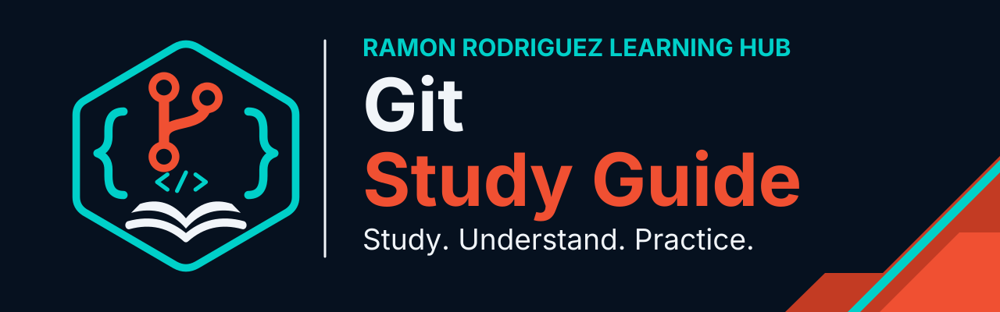

# Git Study Guide

### Estude. Entenda. Pratique.

<strong>Escolha seu idioma</strong> Disponível em 3 idiomas

  
  
  

<!-- learning-hub:start -->

<strong>Ramon Rodriguez Learning Hub</strong> Explore. Aprenda. Construa.

  
  
   Guia atual: Git

<a href="../specs/project-foundation/related-guides.pt-BR.md">Temas de estudo relacionados: Git e Python</a>

<!-- learning-hub:end -->

Criado e mantido por Ramon Rodriguez

  
  
  
  

<!-- technical-badges:start -->

<strong>Tecnologia e integração contínua</strong>

  
  
  
  
  

<strong>Ferramentas e dependências</strong>

  
  
  
  

<strong>Testes e execução</strong>

  
  
  

<strong>Documentação e integridade do repositório</strong>

  
  
  
  
  
  
  
  
  
  

<strong>Engenharia e desenvolvimento</strong>

  
  
  

Snapshot de qualidade verificado: <a href="https://github.com/RamonRDR/git-study-guide/actions/runs/46170050018">GitHub Actions run 46170050018</a>. Main pós-merge c26c41f, 28/11/2026 UTC. Contagens são snapshots, não métricas ao vivo. Ambos os SOs executam a mesma suíte de 156 testes; não somar. Examples verifica política, não execução de todos os labs; links verifica links Markdown internos, não disponibilidade externa; secrets é heurístico.
<!-- technical-badges:end -->

Guia gratuito, independente e multilíngue de Git, GitHub, GitLab, controle de versão e engenharia de software colaborativa, do primeiro commit aos fluxos avançados. Não exige experiência em programação, serviço pago ou IA.

## Como estudar

Comece pelos [Primeiros passos](../../getting-started/README.pt-BR.md), siga o roadmap ou use a referência de comandos para consulta. Leia objetivos, pré-requisitos, efeitos, riscos e estados esperados antes de executar comandos. Pratique em repositórios descartáveis, nunca neste guia ou em produção. Projetos e desafios são locais; atividades hospedadas são opcionais.

## Pré-requisitos

Computador, Git e terminal ou editor. Siga a aula de instalação; muitos laboratórios avançados usam Git 2.40+ e Bash/Git Bash. O CI do mantenedor usa Python 3.12 e biblioteca padrão; Python não é pré-requisito do estudante.

## Roadmap de aprendizagem

<table align="center">
  <thead><tr><th scope="col">Ordem</th><th scope="col">Módulo</th><th scope="col">Entradas</th></tr></thead>
  <tbody>
    <tr><td>00</td><td><a href="../../getting-started/README.pt-BR.md">Primeiros passos</a></td><td align="right">5</td></tr>
    <tr><td>01</td><td><a href="../../fundamentals/README.pt-BR.md">História e fundamentos</a></td><td align="right">3</td></tr>
    <tr><td>02</td><td><a href="../../git-architecture/README.pt-BR.md">Arquitetura do Git</a></td><td align="right">3</td></tr>
    <tr><td>03</td><td><a href="../../basic-commands/README.pt-BR.md">Comandos básicos do Git</a></td><td align="right">5</td></tr>
    <tr><td>04</td><td><a href="../../branches/README.pt-BR.md">Gerenciamento de branches</a></td><td align="right">5</td></tr>
    <tr><td>05</td><td><a href="../../merge-and-conflicts/README.pt-BR.md">Merge e conflitos</a></td><td align="right">7</td></tr>
    <tr><td>06</td><td><a href="../../remote-repositories/README.pt-BR.md">Repositórios remotos</a></td><td align="right">5</td></tr>
    <tr><td>07</td><td><a href="../../history-and-recovery/README.pt-BR.md">Histórico e recuperação</a></td><td align="right">8</td></tr>
    <tr><td>08</td><td><a href="../../github/README.pt-BR.md">GitHub</a></td><td align="right">8</td></tr>
    <tr><td>09</td><td><a href="../../gitlab/README.pt-BR.md">GitLab</a></td><td align="right">8</td></tr>
    <tr><td>10</td><td><a href="../../ci-cd/README.pt-BR.md">CI/CD &amp; Automation</a></td><td align="right">10</td></tr>
    <tr><td>11</td><td><a href="../../professional-workflows/README.pt-BR.md">Professional Workflows</a></td><td align="right">13</td></tr>
    <tr><td>12</td><td><a href="../../security/README.pt-BR.md">Security &amp; Governance</a></td><td align="right">13</td></tr>
    <tr><td>13</td><td><a href="../../advanced-git/README.pt-BR.md">Git avançado</a></td><td align="right">11</td></tr>
    <tr><td>14</td><td><a href="../../git-internals/README.pt-BR.md">Internals do Git</a></td><td align="right">11</td></tr>
    <tr><td>15</td><td><a href="../../command-reference/README.pt-BR.md">Referência de comandos</a></td><td align="right">14</td></tr>
    <tr><td>16</td><td><a href="../../practical-projects/README.pt-BR.md">Projetos práticos</a></td><td align="right">8</td></tr>
    <tr><td>17</td><td><a href="../../exercises/README.pt-BR.md">Desafios e entrevistas</a></td><td align="right">4</td></tr>
  </tbody>
</table>

## Status atual

**Git Study Guide 1.0.** Módulos 00–17 implementados: 141 entradas (115 aulas, 14 categorias de referência, oito capítulos de projetos e quatro de bancos de avaliação), 120 operações catalogadas e 75 registros de avaliação (36 quizzes, 12 desafios, 24 perguntas de entrevista, três simulados). As evidências de QA final e publicação são registradas no [PR #22](https://github.com/RamonRDR/git-study-guide/pull/22); versões oficialmente publicadas constam em [Releases](https://github.com/RamonRDR/git-study-guide/releases). Contrato Learning Hub versionado preparado; runtime no navegador e integração do site são trabalhos separados.

- [Handoff Learning Hub](../../docs/specs/project-foundation/handoff.pt-BR.md)

## Identidade visual

Símbolo original de ramificação, hexágono compartilhado, chaves de código e livro aberto com acento Git laranja. [Guia de identidade visual](../assets/learning-hub/README.pt-BR.md).

## Recursos, governança e contribuição

- [Trilha de aprendizagem](../learning-path.pt-BR.md)
- [Referência de comandos](../../command-reference/README.pt-BR.md)
- [Projetos práticos](../../practical-projects/README.pt-BR.md)
- [Desafios e entrevistas](../../exercises/README.pt-BR.md)
- [Estrutura do projeto](../project-structure.pt-BR.md)
- [Automação de qualidade](../quality-automation.pt-BR.md)
- [Roadmap](../roadmap.pt-BR.md)
- [Especificações](../specs/README.pt-BR.md)
- [Decisões arquiteturais](../adr/README.pt-BR.md)
- [Guia de contribuição](CONTRIBUTING.pt-BR.md)
- [Autoria](AUTHORS.pt-BR.md)
- [Código de conduta](CODE_OF_CONDUCT.pt-BR.md)
- [Política de segurança](SECURITY.pt-BR.md)
- [Suporte](SUPPORT.pt-BR.md)
- [Desenvolvimento assistido por IA](../ai-assisted-development/README.pt-BR.md)
- [MIT License](../../LICENSE)

Criado e mantido por [Ramon Estevez Rodriguez](https://github.com/RamonRDR) (Ramon Rodriguez). ChatGPT e Codex apoiam planejamento e revisão; decisões e aprovações cabem ao mantenedor humano. Projeto educacional independente, sem afiliação, patrocínio ou endosso de Git, GitHub, GitLab, OpenAI ou outras organizações.
